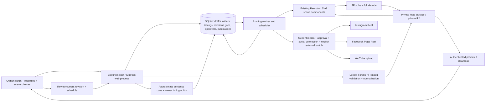

# Tech in 60 Seconds - your script, your recording

The existing creator studio now defaults to **Create -> enter script -> upload narration -> configure scenes/captions -> render and preview -> approve -> schedule -> publish**. No OpenAI key, ElevenLabs account, or paid caption synchronization is required. Prepare your script wherever you prefer and record the narration yourself.

Local dashboard: http://localhost:3000. Local demo login: `creator` / `local-demo-only`. Demo mode always simulates social publication. External publishing is disabled by default.

## Run locally

Node 24.20+ is required for native SQLite. Install Chrome/Chromium, or set `BROWSER_EXECUTABLE`. FFmpeg/FFprobe come from the pinned packages; Docker includes system binaries. Your uploaded recordings need no speech-synthesis package or model download.

```powershell
npm.cmd ci
Copy-Item -LiteralPath .env.example -Destination .env
npm.cmd run dev
```

In a second terminal in the same folder:

```powershell
npm.cmd run worker
```

On Linux/macOS use `npm` and `cp .env.example .env`. For optional sample content run `npm run seed`: existing videos are preserved; a fresh database gets manual RAG/Redis drafts with labelled local synthetic recordings and render jobs. Remaining seeded topics are empty drafts for you to write. The two original rendered samples remain in `artifacts/samples/`.

## Make a video

1. **Create a video:** enter title, topic, language, exact script, and optional official source URLs. Save the draft. An empty script is allowed while drafting, but cannot render. The app does not rewrite or generate text. On an existing legacy video, choose **Use my own script & recording** to copy its saved narration text and storyboard into the manual workflow; its previous approval/media become stale until you attach your recording, render and approve again.
2. **Upload your narration:** choose MP3, WAV or M4A. The owner session, origin and CSRF checks protect the upload. Server-side inspection checks size, actual container/signature, audio presence and measured duration. It rejects video tracks (cover art is allowed), corrupt files, format mismatches, recordings under 3 seconds, and recordings exceeding the configured duration. Files are normalized locally to 48kHz mono PCM WAV for rendering. No recording is sent to an AI service.
3. **Scenes:** choose 1-7 existing interview, process-flow, analogy, failure/recovery or code scenes. Edit their titles, labels and inert pseudocode. Adding/removing scenes resets their duration allocation. Novel visual concepts can require another scene component; arbitrary custom animations are not promised.
4. **Caption & scene timing:** the uploaded recording's measured duration is the timeline. Initial caption cues come from sentence reading-length estimates, split into short chunks for readability. They are explicitly **approximate**, not speech alignment. Listen using the player or each cue's Listen button, edit start/end seconds, and adjust scene durations to fill the recording. Caption words must match your script in order; gaps for silence are allowed, overlapping cues are rejected. Scenes must be continuous and at least 0.25 seconds each. Save timing separately after saving script/scenes.
5. **Render video:** save all pending changes first. The worker loads the private recording and saved caption/scene timing and renders with the original Remotion compositions. It makes no text, voice or alignment API call. Preview the MP4, listen through it, and check claims and sources. Download the original MP4 if desired.
6. **Approve:** explicitly confirm the video, recording, captions and factual claims. Script, storyboard, caption timing, platform text or recording changes invalidate approval and stale media. Replace Recording retains the new recording only after successful validation; invalid replacements leave the old recording intact. Render and approve again after any accepted change.
7. **Schedule and publish:** choose independent times for Instagram, Facebook Page and YouTube in the configured timezone. Demo mode simulates posts; real publishing additionally requires authorized social accounts and explicit external-publishing enablement. Existing processing/reconciliation and duplicate-avoidance behavior remains in use.

Your script is stored exactly as entered. Caption display normalizes whitespace for line layout, but does not add, omit or rewrite words. Platform post titles/descriptions are separate editable text. The app cannot verify that your recording says the script; you check that during preview.

English, Hindi and Hinglish scripts and recordings work without AI-provider accounts. Noto Sans Devanagari/Latin fonts are bundled. No forced-alignment model is installed; multilingual and unusually paced recordings can require more manual timing edits. No word-level speech accuracy or transcription is claimed. Owner-edited timing is labelled as such, not certified alignment.

## Configuration and optional credentials

| Setting | Default / purpose |
| --- | --- |
| `DEMO_MODE` | `true`; all social publishing is simulated |
| `ENABLE_AI_FEATURES` | `false`; legacy AI generation is opt-in only |
| `MAX_AUDIO_UPLOAD_MB` | `30`; server and UI size bound (maximum configurable 200MB) |
| `MAX_VIDEO_DURATION_SECONDS` | `60`; configurable 3-60-second maximum |
| `STORAGE_PROVIDER` | `local`; private filesystem storage by default, optional `r2`. Old `STORAGE` remains a fallback. |
| `LOCAL_STORAGE_PATH` | `./data/media`; narration, visual assets and final videos. Relative paths resolve from the project directory. |
| `MEDIA_HOST_PATH` | Docker host media folder, default `./data/media`; shared at `/app/media` by both processes. |
| `PUBLIC_MEDIA_ORIGIN` | Optional HTTPS application origin for live Instagram delivery; falls back to `PUBLIC_ORIGIN`. |
| `MEDIA_LINK_TTL_HOURS` | `48`; scoped publishing link lifetime, configurable from 1 to 168 hours. |
| `PUBLIC_ORIGIN` | `http://localhost:3000`; exact browser origin / OAuth callback base |
| `DATA_DIR` | `./data`; persistent SQLite, work, temporary processing and any legacy media/uploads |
| `BROWSER_EXECUTABLE` | Optional Chrome/Chromium path; Windows Chrome is detected by the renderer default |
| `OWNER_USERNAME` / `OWNER_PASSWORD` | Single-owner login; replace demo password for production |
| `SESSION_SECRET` / `TOKEN_ENCRYPTION_KEY` | Separate random values of at least 32 characters in production |

**OpenAI and ElevenLabs credentials are optional.** Manual creation, uploads, captions and rendering ignore them even if configured. Legacy generation is exposed only with `ENABLE_AI_FEATURES=true`; see [optional AI setup](docs/OPTIONAL-AI.md). Automatic AI planning is off on upgrade and requires separate explicit enablement. Spending reservations and bounded retries still apply to that optional path; they are estimates, not invoice accounting or provider billing guarantees.

For real publishing, set the appropriate Meta/Instagram/Google OAuth app credentials and authorize your accounts through Connections. See [social account setup](docs/SOCIAL-CONNECTIONS.md) for exact scopes, callback paths, app review and token renewal. No social-account password needs to be stored in this app. Live integrations remain untested with your accounts.

### Your own media folder (default)

```dotenv
STORAGE_PROVIDER=local
LOCAL_STORAGE_PATH=./data/media
```

The folder is created automatically. Set an absolute `LOCAL_STORAGE_PATH` to use another private disk folder. Web and worker must share that folder and account permissions. New narration uses `audio/<UUID>.wav`, finished videos use `videos/<UUID>.mp4`, and visual assets can use the same storage abstraction. Records contain provider/key/size/hash/type metadata instead of absolute machine paths. Legacy recordings in `DATA_DIR/uploads` and videos in `DATA_DIR/media` continue resolving there without silently rewriting references.

Default media/data folders, artifacts and environment files are excluded from Docker builds. If you choose a differently named media folder inside the project, add it to `.dockerignore` before building, or use a host folder outside the build context.

Connections shows storage readiness and the folder. Missing files return HTTP 404; unreadable/unwritable or invalid folders return HTTP 503; detected disk-full/quota failures return HTTP 507. Fix the folder or restore the file before retrying. Preview and download routes require authentication and support byte ranges. Media cannot be placed in `dist`, `public`, `.render-bundle` or the project root. The private tree rejects unsafe keys, symbolic links/junctions and hardlinks. Do not serve your data folder publicly.

### Publishing with local files

Facebook and YouTube upload original local bytes directly. Instagram's current adapter needs a URL Meta can fetch. Localhost works for local generation and simulated posts, but cannot be fetched by Meta. For live Instagram only, configure an existing publicly reachable HTTPS application origin using `PUBLIC_MEDIA_ORIGIN` (or `PUBLIC_ORIGIN`) and route `/delivery/media/*` to the web process. No tunnel or hosting is configured automatically. The hostname setting does not verify reachability; check your DNS, TLS and routing before live use.

Delivery links expire and are scoped to one publication, approved revision and finished video. Expired, tampered, cancelled and superseded links are denied. Narration and folder listings are not exposed. Missing public hosting blocks only Instagram delivery; rendering, playback, downloads and direct Facebook/YouTube uploads remain available. Provider processing and reconciliation still determine successful publication.

### Optional R2 and explicit migration

Local operation needs no R2 credentials. To use the preserved remote adapter, set `STORAGE_PROVIDER=r2` and the four `R2_*` credentials. Keep the bucket private. Existing R2-tagged records stay tagged after changing the default; absent cached files still require the original R2 credentials. Reading an old asset does not rewrite its reference or delete the remote original.

To migrate R2 assets, back up the database, stop both processes, and ensure affected videos have no pending jobs or unresolved publications. Then run:

```sh
npm run migrate:r2 -- --dry-run
npm run migrate:r2 -- --apply
```

Dry-run lists candidates without downloads or media-reference changes. Apply checks expected size/hash, verifies local copies, then updates references transactionally only if the video has not changed. Remote originals are never deleted. Pre-metadata R2 assets are not guessed automatically; use `--include-legacy-r2` only after confirming the original bucket/key layout. Failed migration may leave a private unreferenced local copy; references stay unchanged. Real R2 migration has not been tested against your bucket.

## Data compatibility, security and reliability

Migrations apply transactionally on startup. `002_manual_workflow.sql` adds workflow mode, original script, private audio metadata, captions and scene timings. Existing content stays in legacy mode with its prior documents/media/revisions/publication records intact. It defaults AI planning and external publication to off for the upgrade. The manual-workflow upgrade previously backed up the database. Storage verification uses an isolated database and leaves the owner database untouched. The existing 003_storage migration adds nullable media metadata without rewriting old references.

The same durable SQLite WAL jobs, leases, serialized rendering, revision fences, retry backoff and independent publication records remain in use. Manual edits cancel stale work; stale upload/editor revision numbers are rejected. Rendering/retries do not create publication jobs. Only approval plus explicit scheduling does so. Expired publication leases or uncertain remote mutations require reconciliation, avoiding blind repeat posts. Times use IANA zones and reject DST gaps/ambiguous fallback times.

Binary uploads are authenticated before the audio-body parser, limited in size, and use generated identifiers rather than client filenames. Input signatures select bounded audio demuxers; FFprobe/FFmpeg run using argument arrays, never shell-built commands, with permitted local protocols and timeouts. Normalization output is bounded; exceeded duration is rejected rather than attached as a shortened recording. Temporary processing directories are checked to remain under the private upload-temp root and removed on success/failure. Valid replacement cleanup removes only the obsolete local recording/cache, never its remote R2 original; a cleanup failure leaves an obsolete private file for maintenance instead of breaking the accepted recording. Uploads are buffered in memory up to their configured limit; retain a reasonable limit for this single-owner deployment.

Management APIs, audio/video playback, uploads and timing edits require owner authentication. Mutations require origin and CSRF checks. Production cookies are Secure/HttpOnly/SameSite; tokens and remote checkpoints use AES-256-GCM. Provider secrets come from environment variables, are excluded from source control, and are not included in diagnostic exports. Manual reference URLs must use approved HTTPS documentation domains; they are retained as owner references rather than automatically retrieved or fact-checked.

## Architecture



`server/manual.ts` handles manual drafts and validated timing. `server/uploads.ts` handles local recording validation, normalization and attachment. `server/revisions.ts` shares mutation guards. `src/manual.tsx` extends the existing dashboard. `server/workflow.ts` dispatches manual renders through the original queue and renderer. Provider adapters and OAuth flows remain in their existing modules.

## Docker Compose deployment

Docker Desktop / Engine must be running. The Docker engine was stopped during storage verification. Compose configuration was validated; container startup was not tested. No paid infrastructure was deployed.

1. Set unique `OWNER_PASSWORD`, `SESSION_SECRET`, and `TOKEN_ENCRYPTION_KEY` in `.env`; secrets must have at least 32 characters. Use separate random values. Preserve the encryption key with your backups.
2. Set `PUBLIC_ORIGIN=https://YOUR_HOST`. Terminate HTTPS using your existing reverse proxy and forward to `127.0.0.1:3000`. The app trusts exactly one proxy in production; only expose it behind that trusted proxy. Ensure the proxy preserves the origin and supports byte ranges and large media responses. Do not expose the volume or serve `data/` as a public directory.
3. Keep `DEMO_MODE=true` to test production deployment without provider costs. Production intentionally refuses the default password, missing explicit secrets, or non-HTTPS origin, even in demo mode.
4. Run:

```sh
docker compose config --quiet
docker compose up --build -d
docker compose exec web npm run seed
docker compose logs --tail=100 web worker
```

The image includes Chromium, FFmpeg, Noto fonts, offline speech, and an init process. It runs as non-root `node`. Web and worker share the named `studio-data` volume for SQLite, work, heartbeats and legacy media, plus the same host media bind mount at `/app/media`. `MEDIA_HOST_PATH` chooses the host folder (default `./data/media`); Compose deliberately sets `LOCAL_STORAGE_PATH=/app/media` inside both containers. Changing this host path does not move old files automatically. Persistent storage must be on a local filesystem supporting SQLite file locking; do not place the database on NFS or object storage. Worker shutdown allows ten minutes for an in-progress render; abrupt interruption falls back to the lease recovery rules. Rendering can need several GB of RAM and CPU; start at frame concurrency 1. The database remains on the named volume; media stays in your host folder unless you explicitly select R2.

Before starting Docker, create `MEDIA_HOST_PATH`. On Linux, the non-root image uses UID/GID 1000: grant that user read/write/traverse access (for a new dedicated folder, `mkdir -p ./data/media && sudo chown 1000:1000 ./data/media && chmod 700 ./data/media`). Do not recursively change ownership of an unrelated existing directory. On Windows/macOS, grant Docker Desktop access to the selected folder; on native Windows grant the account running both processes read/write/modify access. Avoid public web directories. Back up this host folder in addition to the database volume.

For a local Docker smoke test use your local HTTPS reverse proxy and an HTTPS `PUBLIC_ORIGIN`, or run the Docker image with development environment explicitly and localhost demo defaults. Secure production cookies will not work over ordinary HTTP.

## Backup and restore

```powershell
npm.cmd run backup
```

This uses SQLite’s online backup API to create a consistent timestamped database in `data/backups` while WAL is active. Protect backups as confidential: they contain scripts, session records, and encrypted provider grants. For a coherent database-and-media snapshot, stop BOTH web and worker to prevent uploads or edits, run the backup, then copy the actual `LOCAL_STORAGE_PATH` and any legacy `DATA_DIR/media` and `DATA_DIR/uploads` directories. Keep `DATA_DIR/work` if you want cached legacy narration. A database backup alone does not contain the media files. Preserve the exact token encryption key in a separate secret store. Back up the private R2 bucket separately if using R2. Do not copy only `studio.sqlite` while a writer is running; the WAL may contain newer data.

Restore with **both processes stopped**:

```powershell
# Use your explicit backup path and the intended data folder.
Copy-Item -LiteralPath 'data\backups\YOUR_BACKUP.sqlite' -Destination 'data\studio.sqlite'
Remove-Item -LiteralPath 'data\studio.sqlite-wal','data\studio.sqlite-shm' -ErrorAction SilentlyContinue
# Restore the matching LOCAL_STORAGE_PATH and legacy media/uploads/work copies.
# Keep the same encryption key, then restart.
```

Before restoring a database after any live publishing, disable external publication and inspect the restored publication records against platform state. A backup can predate a real post. Recovering those records without reconciliation can create duplicates. Restored in-progress publication jobs become uncertain once their lease expires. Delete restored sessions if the snapshot was exposed. Docker: stop worker/web, restore the database in the named data volume AND the media in MEDIA_HOST_PATH through your backup tools, then restart; do not run two active databases against the same publication records.

## Validation and reproducible manual demo

With the web process running and the worker stopped so the demo runner can own its jobs:

```powershell
npm.cmd test
npm.cmd run build
npm.cmd run demo:manual
npm.cmd run test:manual-ui
npm.cmd run test:ui
```

The manual demo requires local Demo mode, no configured OpenAI/ElevenLabs key, and external publishing disabled. It uses **fixtures/rag.wav**, a clearly labelled local synthetic narration fixture, and the supplied matching sample script. It saves through the authenticated API, uploads/normalizes, configures scenes and captions, renders, fetches the private preview, approves and simulates all three platforms. It checks that usage does not increase and blocks paid AI endpoints in its runner. It creates a fresh demo story each run; it does not overwrite your original videos.

Output: [manual demonstration MP4](artifacts/samples/manual-local-fixture.mp4), [measurements and simulated outcomes](artifacts/manual-demo-report.json), screenshots/frame captures in `artifacts/manual-qa/`, and [update report](MANUAL-WORKFLOW-REPORT.md). The original RAG/Redis sample videos and their prior report remain available. Browser tests use actual Chrome; provider contract tests use mocked transport and do not certify live account access.

`npm run verify` still verifies both original sample videos. `npm run demo` is the original legacy demo runner, useful with the already-rendered samples; new legacy generation requires the explicit AI feature switch. New uploaded narration never needs `npm run fixtures` or an offline synthesis engine. `npm run fixtures` only regenerates the labelled synthetic demonstration assets.

Troubleshooting:

- **Worker offline:** run `npm run worker` in another terminal using the same data directory. Jobs remain durable.
- **Invalid/overlong upload:** export audio-only MP3/WAV/M4A, check the configured size/duration, and replace it. The app never silently truncates your recording.
- **Captions drift:** estimates are not forced alignment. Use Listen for each cue, adjust start/end and scene durations, save timing and rerender. Verify that the script matches the recording.
- **Render button disabled:** save pending script/scene/timing edits, attach audio, add a nonempty script, or wait for the current job. Save and render again after replacing audio.
- **Caption validation fails:** keep the exact script words in order, prevent overlapping cues, and keep all times inside the recording. Scene durations must cover the full recording.
- **Stale revision error:** another save/upload changed the draft. Refresh and retry deliberately; the app will not overwrite the newer revision.
- **Render fails:** check disk/RAM/browser path, reduce frame concurrency, then retry in Job history. Manual jobs do not require voice/model configuration.
- **401/403 on publishing:** reconnect the appropriate social account, check permissions/app review/quota. Do not retry an uncertain result without reconciliation.
- **Origin/CSRF error:** browse using exactly `PUBLIC_ORIGIN`; localhost and 127.0.0.1 are different origins.
- **PowerShell blocks npm.ps1:** use `npm.cmd`; no global execution-policy change is needed.

No real posts or paid AI calls were made during the manual update. Production R2, real-account uploads, and Docker runtime validation remain external setup/smoke tests. See the update report for checks actually run and unresolved limitations.


## Isolated local-storage verification

`npm run test:storage-http` runs HTTP upload/privacy/range/missing-file checks, a complete Remotion render with the bundled synthetic fixture, download verification, expired-link checks and simulated publishing to all three platforms. It refuses to run unless `STORAGE_CHECK_ALLOW=true`, Demo mode, local storage, AI disabled and the test server has no AI/R2 credentials. Use a separate `DATA_DIR` and `LOCAL_STORAGE_PATH`, a dedicated localhost port and matching owner credentials/secrets in both processes. Start only the web process; the runner owns the worker jobs. Never point this check at your owner database.

The runner saves measurements and screenshots under the test `DATA_DIR`. Stop and restart that web process with the same test environment, then run `npm run test:storage-http -- --resume` to verify persistent database records, narration, video bytes and simulated publication results. It never posts real videos. `npm test` also covers identifier/link protection, storage error classification, legacy references and explicit R2 migration using an injected fixture transport. Actual disk exhaustion and real R2/account access are not exercised.

See LOCAL-STORAGE-REPORT.md for the completed verification and remaining deployment requirements.
